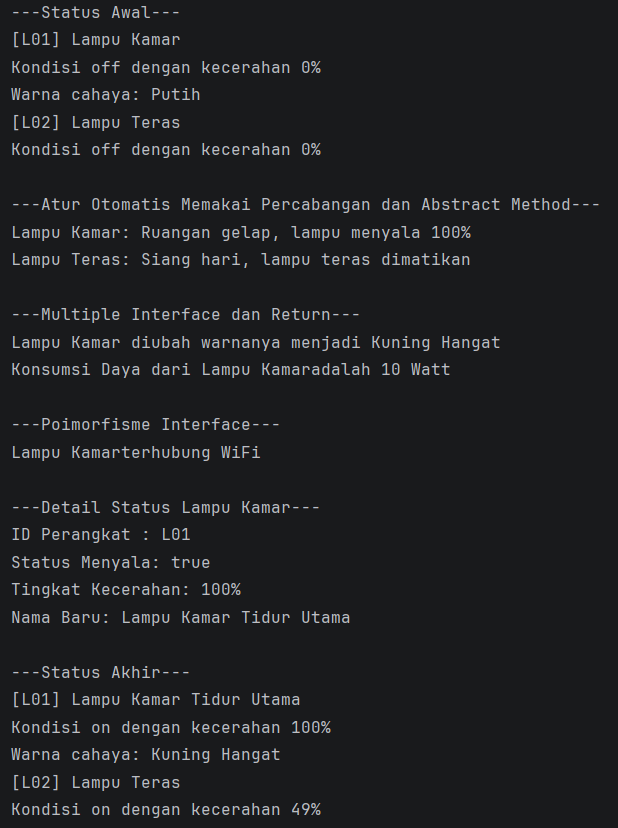

NAMA: MIFTACHUDDIN ACHMAD
NIM: H1D015104
TEMA: IoT

# Simulasi Sistem IoT Smart Lamp

## Prasyarat
* Java Development Kit (JDK) versi 8 atau yang lebih baru.
* Terminal / Command Prompt / PowerShell.

## Petunjuk
1. Buka terminal pada direktori utama project.
2. Compile seluruh file dengan perintah:
   `javac -d out src/SmartLampPBO/*.java`
3. Jalankan program dengan perintah:
   `java -cp out SmartLampPBO.Main`

## Ringkasan Alur Pengujian (Main.java)

1. **Inisialisasi & Status Awal**: Membuat objek `lampuKamar` dan `lampuTeras` melalui overloaded constructor, kemudian menampilkan status awal kedua perangkat.
2. **Otomasi Sensor**: Menjalankan method abstract `aturOtomatis()` dengan logika percabangan berdasarkan nilai sensor cahaya.
3. **Multiple Interface & Method Return**: Menguji interface `KontrolWarna` untuk mengubah warna cahaya dan memanggil fungsi return `hitungDayaWatt()`.
4. **Polimorfisme Interface**: Mengakses method `hubungkanWiFi()` milik `lampuKamar` melalui variabel referensi bertipe interface `Konektivitas`.
5. **Getter & Setter**: Membaca atribut `idPerangkat`, `menyala`, `kecerahan`, serta mengubah nama perangkat dengan `setNama()`.
6. **Status Akhir**: Mengubah state `lampuTeras` secara manual lalu mencetak rekap status akhir kedua perangkat.

## Luaran

